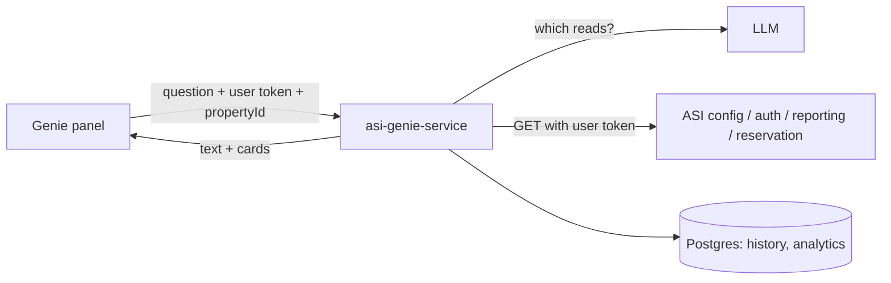

# ASI Genie — Orchestrator

Go service behind **ASI Genie**, the chat assistant in the hotel PMS. It reads ASI data with the signed-in user's own token, for one property at a time, and answers with short text plus cards (tables, charts, lists). It never writes to ASI.

**Module:** `asi-genie-poc` · **Port:** `8090`

## Documentation

| Doc | For | Contents |
|-----|-----|----------|
| [docs/genie-for-everyone.md](docs/genie-for-everyone.md) | Everyone (ops, support, product, QA) | What Genie does, what to ask, what it won't do, safety, error messages |
| [docs/developer-guide.md](docs/developer-guide.md) | Developers & leads | Architecture, flow diagrams, code map, local setup, config, common changes |
| [docs/response-contract.md](docs/response-contract.md) | Frontend / API consumers | `/chat`, `/chat/stream` and card shapes |
| [docs/database.md](docs/database.md) | Developers | Postgres tables and what is stored |
| [docs/phase1-coverage.md](docs/phase1-coverage.md) | Product / leads | Scenario catalogue vs fallback handlers (generated) |

## Quick start

```bash
cp .env.example .env     # POSTGRES_PASSWORD, ASI_*_BASE_URL, LLM keys
make dev                 # Postgres (docker) + service on :8090
curl -s localhost:8090/health
```

Full setup, configuration and troubleshooting: [developer-guide.md](docs/developer-guide.md).

## How it works



1. The frontend sends the message, `propertyId` and the user's token.
2. Genie checks the user is allowed on that property.
3. The LLM picks up to 3 allowed read endpoints (`plan_reads`); Genie runs them with the user's token.
4. The LLM turns the results into text and cards (`present_answer`).
5. If the LLM can't plan, a keyword/intent router with dedicated handlers answers instead.

## Common commands

```bash
make test           # go test ./...
make gen            # regenerate tools + intents, build, vet
make gen-registry   # Swagger from sibling asi-*-service repos → toolregistry/generated
make docker-build   # production image
make help           # everything else
```

## Related repos

- **asi-frontend** — Genie panel (`NEXT_PUBLIC_GENIE_API_URL`).
- **asi-config-service**, **asi-auth-service**, **asi-reporting-service**, **asi-reservation-service** — upstream read APIs and Swagger sources.
