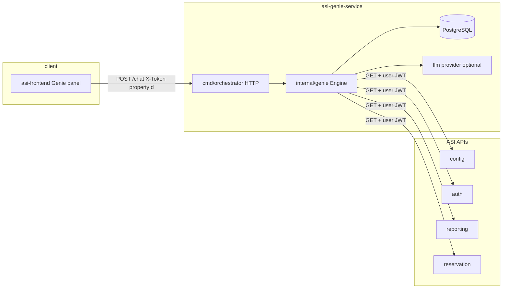

# Architecture

ASI Genie orchestrator is a **Go HTTP service** that sits between the **asi-frontend** chat UI and existing **ASI microservices** (config, auth, reporting, reservation). It plans **read-only** backend calls from the user’s question, runs them with the user’s token, and returns **typed UI cards**. Intent classification remains the fallback when the planner cannot run. It does not modify ASI services or perform writes on their behalf.

## System context



## Repository layout

```
asi-genie-service/
├── cmd/orchestrator/       # HTTP server: routes, CORS, chat handler
│   ├── main.go             # Startup: LLM, ASI URLs, Postgres, mux
│   └── chat.go             # POST /chat, history, analytics, events
├── internal/
│   ├── genie/              # Core engine (see below)
│   ├── cards/              # Response card types + Finalize() for legacy fields
│   ├── intents/            # Capability catalogue (catalog_gen.go generated)
│   ├── store/              # Postgres persistence interface + GORM models
│   ├── asienv/             # Required ASI_*_BASE_URL validation
│   └── logx/               # Structured CHAT / LLM / ASI logging
├── toolregistry/
│   ├── generated/          # Swagger-generated HTTP tools (per ASI service)
│   └── hooks.go            # Permission / card mapping hooks (stubs)
├── llm/                    # OpenAI, Anthropic, Gemini behind LLMClient
├── scripts/
│   ├── gen-registry/       # specs → toolregistry/generated
│   └── gen-intents/        # Scenarios.csv → catalog_gen.go
├── specs/                  # Local Swagger 2.0 copies + genie catalogue CSVs
├── docs/                   # This file, response contract, coverage, DB, local dev
├── docker-compose.yml        # Postgres only
└── Dockerfile              # Deploy image (orchestrator binary)
```

### `internal/genie` (engine)

| Area | Files | Role |
|------|--------|------|
| Entry | `engine.go` | `Engine.Handle`: PCI guard → planner, or classify → dispatch → persist |
| Planner | `planner.go`, `present.go` | Model picks allowed reads, server runs them, model shapes cards |
| Scope | `hotel_scope.go`, `create_guide.go` | Hotel-term reads; verified create/update screens |
| Routing | `classify.go` | Fallback: LLM `route_intent` or keyword match; slot extraction |
| Handlers | `handlers.go`, `handlers_phase1_extra.go`, `handlers_people.go` | Dedicated scenarios when the planner does not own the turn |
| Generic | `generic.go` | Catalogue P1/P2: navigate, not supported, LLM-picked GET |
| Tools | `tools.go` | Allow-list, keyword selector, execute generated tools |
| Navigation | `links.go`, `navigate.go` | Deep links aligned with asi-frontend routes |
| Reports | `report_catalog.go` | Live report list; night-audit report ids rewritten to names |
| Errors | `errors.go` | ASI errors → user-facing error cards |
| JSON helpers | `jsonx.go` | Parse list/data from ASI responses |

In-memory **session** state (last entity, last intent, business date cache) lives in `Engine` keyed by `sessionId`; durable history is in Postgres.

## Request pipeline (`POST /chat`)

1. **Validate** — `propertyId` required (body or `X-Property-Id`); group scope rejected. User JWT from `X-Token` / `Authorization` / cookie.
2. **PCI guard** — Luhn card patterns masked; reply is a `denied` card; event `pci_block`. Card numbers never reach the model.
3. **Session** — Bind conversation to property; reset context if property changes.
4. **Business date** — Night-audit working date (cached 10 min), or `businessDate` from the request. "Today" in the planner is this date, not the server clock.
5. **Plan** (when an LLM is configured and the turn is not an export or a reply to a pending clarify card):
   - One `plan_reads` tool call. The model sees every allowed read (core index with hand-written guidance, the reads that best match the question with their query params, and every other allowed read by name).
   - `action=read` runs up to 3 GETs in parallel with the user's token. `propertyId` and `/properties/{id}` are forced to the active property. A required date the model left out is filled from the business date (a missing `startDate` copies `endDate` and the reverse). A required non-date param that is still empty is not sent; the API error detail goes back so a second round can correct it.
   - A second round runs only when the model set `followUp` (it needs an id from the first results) or a read failed with a client error it can fix. At most two rounds.
   - `present_answer` turns those JSON results into `text` plus `data` / `chart` / `table` / `list` cards. Numbers are copied from the reads; database ids are shown as names when the JSON has a name.
   - `action=refuse` with a known create/update entity returns a `navigate` card to the verified ASI screen (`create_guide.go`). Other refusals and `action=reply` use the model's message for that question.
6. **Classify and dispatch** — only when the planner does not own the turn (no LLM, planner call failed, file export, or an answer to a pending clarify card). One `route_intent` call over the capability catalogue, or keyword match, then a dedicated or generic handler.
7. **RBAC** — No Genie-side permission matrix; 401/403 from ASI → `denied` card.
8. **Respond** — `text`, `cards`, `chips`, `intent`, `toolCalls`, `durationMs`, optional `notice`.
9. **Persist** — Append messages, log tools, log turn analytics, log events.

Writes, payments, refunds, and check-in/out actions are never executed. Non-GET tools and sensitive GETs (admin, impersonation, invite, internal, audit-log, export) are dropped at startup (`IsAllowedReadTool`) and cannot be invoked, including by a planner tool name.

## Tool registry

- Generated from each service’s Swagger (`scripts/gen-registry`). Do not hand-edit `toolregistry/generated/`.
- Naming: `reservation_get_reservations` ↔ `ReservationGetReservations`.
- `ToolMeta` carries `Query` (`[]QueryParam{Name, Required}`) for every query parameter the spec declares. The planner prints those names (required ones marked `*`) so a named report is called with its own params instead of a nearby read.
- `toolregistry/generated/client.go` forwards the user JWT on outbound calls.
- Base URLs from env: `ASI_CONFIG_BASE_URL`, `ASI_AUTH_BASE_URL`, `ASI_REPORTING_BASE_URL`, `ASI_RESERVATION_BASE_URL`.

Regenerate after API changes: `make gen-registry` or `make gen-registry-local` (uses `./specs`). The planner picks up new reads from the regenerated metadata; the core index in `planner.go` is only extra wording for the common questions.

## Intent catalogue

- Source: `specs/catalogue/genie-catalogue/Scenarios.csv`
- Generated: `internal/intents/catalog_gen.go` via `make gen-intents`
- Coverage matrix: `docs/phase1-coverage.md` (regenerate with `scripts/gen-intents/gen_coverage.py`)

## Frontend contract

- API shape: [response-contract.md](./response-contract.md)
- asi-frontend: `NEXT_PUBLIC_GENIE_API_URL`, Genie shell on `/property/[id]/…`, session id in sessionStorage per property.

## Code generation

```bash
make gen                 # registry + intents + build + vet
make gen-registry        # read ../asi-*-service specs (default -root ..)
make gen-registry-local  # read ./specs/*.swagger.json
make gen-intents         # Scenarios.csv → catalog_gen.go
```

## Logging

Boxed blocks on stderr (`internal/logx`): `CHAT`, `LLM`, `ASI`. Secrets, tokens, and card numbers are masked. See README → Logging (env: `LOG_LEVEL`, `LOG_BODIES`, `LOG_BODY_MAX`, `LOG_COLOR`).

## Deploy notes

- **Dockerfile** builds `./cmd/orchestrator` (multi-stage Alpine).
- **docker-compose** in repo is for **local Postgres only**; orchestrator is typically run with `go run` or the container image in deploy environments.
- Requires Postgres + all four ASI base URLs + LLM config (or `LLM_PROVIDER=none`).
