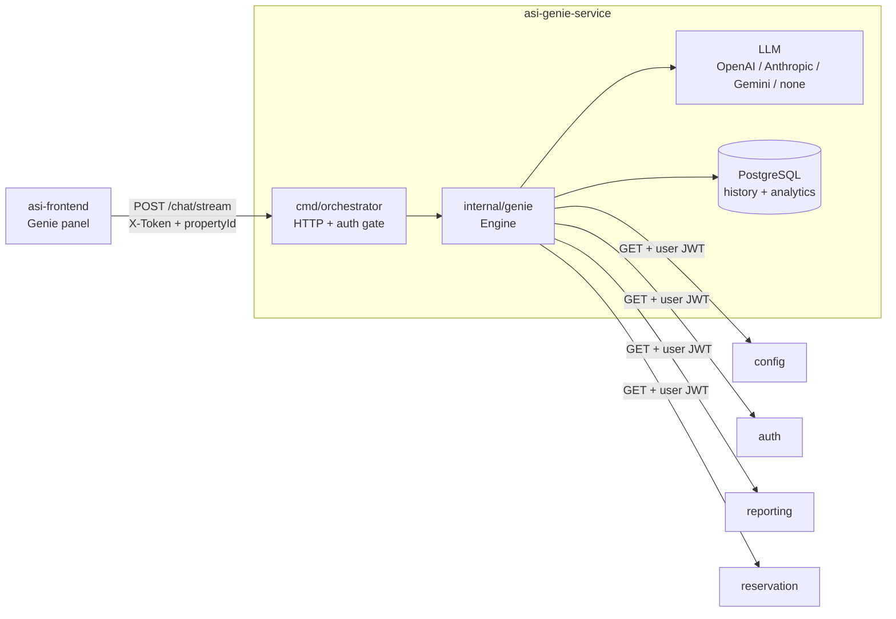
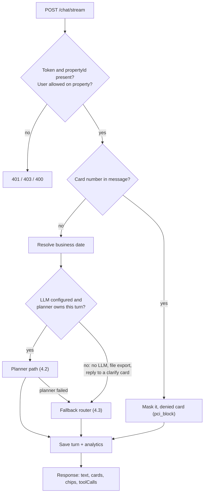
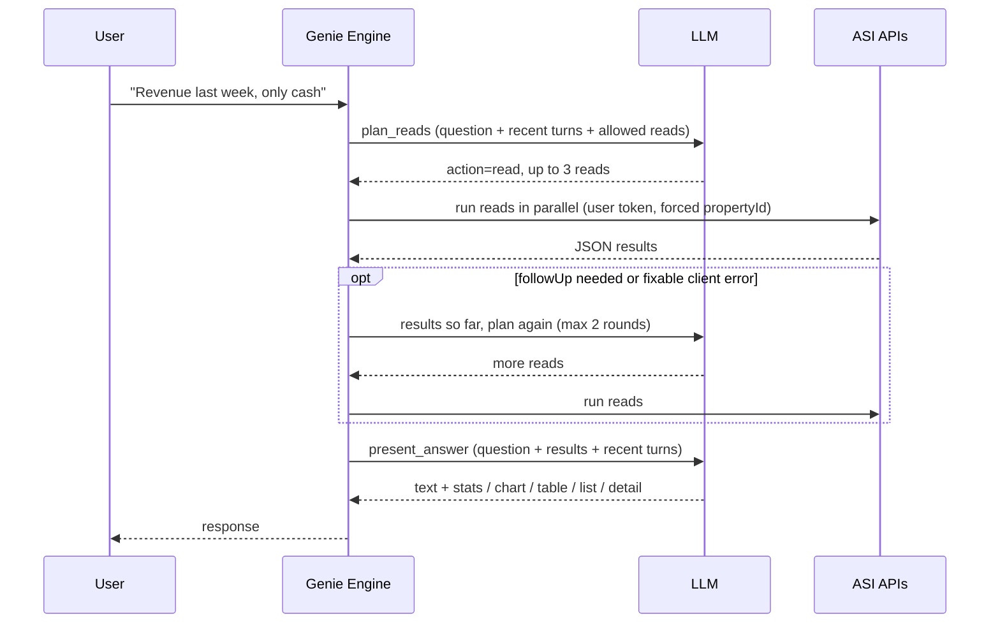

# ASI Genie — developer

## 1. In one paragraph

`asi-genie-service` is a Go HTTP service (port `8090`, module `asi-genie-poc`) that sits between the **asi-frontend** Genie panel and the four ASI APIs (**config, auth, reporting, reservation**). For each chat message it asks an LLM which **read-only GET** endpoints answer the question, runs them **with the user's own token** for **one property**, and asks the LLM to turn the JSON into a short text plus typed **cards** (stats, table, chart, list, ...). If the LLM can't plan, a keyword/intent router with hand-written handlers answers instead. Genie never writes to ASI.

## 2. Key rules (what leads should know)

| Rule | How it's enforced |
|------|-------------------|
| **Read-only** | Only `GET` tools marked read-only are loaded. `admin`, `impersonat`, `invite`, `/internal/`, `audit-log`, `export` paths are dropped at startup (`IsAllowedReadTool`). The model can't call anything else, even by name. |
| **User's permissions, not ours** | Every ASI call forwards the user's JWT. Genie has no permission matrix; ASI's 401/403 become `denied` / `error` cards. See [4.6](#46-access-control-rbac). |
| **One property** | `propertyId` is required. Before each request, `Authorize` checks that the property is in the user's `auth /permissions`. The planner can't widen scope: `propertyId` and `/properties/{id}` are overwritten with the active property. |
| **No card numbers** | Luhn-valid card numbers are masked before the model, the logs and the database see them. The reply is a `denied` card (`pci_block`). |
| **Numbers come from ASI** | The answer prompt copies figures from read results; ids are shown as names where the JSON has them. |
| **"Today" = business date** | Night-audit working date (cached 10 min), or `businessDate` from the request. Not the server clock. |

## 3. System diagram



## 4. How one message is answered

### 4.1 Overall flow



### 4.2 Planner path (the main path)



Step by step (`planner.go`, `present.go`):

1. **Plan** — one `plan_reads` tool call. The prompt lists every allowed read: a hand-written core index (`plannerIndex`) for common questions, the reads that best match the question with their query params, and all other allowed reads by name. Recent turns (last 6 messages) are included so "yes, do it" or "only cash" continue the previous turn.
2. **Actions** the model can return:
   - `read` — run up to **3** GETs in parallel.
   - `reply` — greeting, thanks, definition with no data. Greetings get the user's first name and time of day (from the request's `localHour`, else the server clock).
   - `refuse` — out of scope. For a create/update of a known entity (room, rate type, reservation, guest, ...) the server returns a `navigate` card to the verified ASI screen (`create_guide.go`). A hotel term ("what is RevPAR?") is turned into a read instead of a refusal (`hotel_scope.go`).
3. **Fill params on the server** (`runRead`):
   - `propertyId` and `/properties/{id}` are always set to the active property.
   - Missing **required** dates: copy the partner (`startDate`↔`endDate`) or use the business date.
   - Missing comma-separated **filter** params (`paymentMethods`, `status`, ...) default to every value in the spec (`ToolMeta.Query[].AllValues`). Several reports treat a missing filter as "match nothing".
   - A required param that is still empty is **not sent**; the error goes back to the model for round 2.
4. **Round 2** only if the model set `followUp` (needs an id from round 1) or a read failed with a fixable client error. Maximum **2** rounds.
5. **Short-circuits before the answer call**: every read denied → `denied` card; every read down (5xx / timeout) → `error` card with `service_unavailable` (`outageCard`).
6. **Present** — `present_answer` returns `text` plus up to: 8 stats, 1 chart (≤4 series, ≤60 points), 1 table (≤8 columns, ≤50 rows), 1 list (≤30 items), detail rows (≤16). Generic titles ("Report", "Table") are replaced from the question.

If the plan or present call fails, `planAndAnswer` returns `false` and the fallback router answers. The response carries `notice` ("The assistant is busy right now…").

### 4.3 Fallback router

Used when there is no LLM (`LLM_PROVIDER=none`), the planner failed, the user asked for a file export, or the message answers a pending clarify card.

1. **Classify** (`classify.go`) — one `route_intent` LLM call over the capability catalogue, or keyword matching. Extracts slots (dates, names, ids).
2. **Context** — fill missing slots from the session (last guest / reservation / room), resolve follow-ups.
3. **Dispatch** (`handlers*.go`, `generic.go`) — a dedicated handler (arrivals, departures, availability, folio balance, night audit readiness, ...), a generic handler (LLM picks one GET, server renders the card), a navigate card, or not-supported.
4. **Errors** never surface raw: `errorCard` maps 401 → `session_expired`, 403 → `forbidden`, timeout → `service_unavailable`, 5xx → `service_error`.

### 4.4 After every turn

`persist` writes: user + assistant messages (`messages`), one analytics row (`genie_turns`), each ASI call (`tool_executions`), and events (`intent`, `denied`, `unsupported`, `pci_block`). See [database.md](./database.md).

### 4.5 Streaming

`POST /chat/stream` is the only chat endpoint. After the turn finishes it sends Server-Sent Events: `tool_start` / `tool_end` per read (with a label like "Checking revenue"), `text_delta`, one `card` per card, `chips`, `done`. Auth and engine failures are an `error` event with the HTTP status.

### 4.6 Access control (RBAC)

Genie does not keep a permission matrix. ASI is the authority. There are two checks.

**Property membership, before the turn.** `Authorize` (`authz.go`) runs on `/chat/stream`, history, feedback, and analytics. It calls auth current-user and `GET /permissions` with the user's token (cached 10 minutes per token). The request `propertyId` must appear in that payload.

| Result | HTTP |
|--------|------|
| Missing or rejected token | `401` Sign in to use Genie. |
| Property not in the user's permissions, or auth returns 403 | `403` You don't have access to this property. |
| Auth unreachable | `502` Genie couldn't verify your sign-in. |

Every read overwrites `propertyId` and `/properties/{id}` with this property, so a planned call cannot ask about another one. History and feedback are also limited to this caller and property.

**Feature permission, during the turn.** Each ASI GET uses the same JWT, and ASI enforces Module → Feature → Permission on that call. Catalogue `RBAC` / `Requirements` (from `Scenarios.csv`) record which permission a scenario needs. Genie does not filter intents against those strings before the model runs.

When a read is refused:

- **Planner:** if every planned read is 401 or 403, the reply is one `denied` card ("That isn't available for your role.") and no figures.
- **Fallback router:** 401 becomes an `error` card `session_expired`; 403 becomes `forbidden`. That path also stores a `denied` event.

A `denied` card is also used when the message contains a card number (`pci_block`). That is PCI masking, separate from role checks.

## 5. Code map

```
asi-genie-service/
├── cmd/orchestrator/      main.go (startup, routes, CORS) · chat.go (handlers, auth gate, SSE)
├── internal/
│   ├── genie/             the engine — see table below
│   ├── cards/             card types + Finalize() (legacy flat fields)
│   ├── intents/           capability catalogue (catalog_gen.go is generated)
│   ├── store/             Store interface + Postgres/GORM models
│   ├── asienv/            validates ASI_*_BASE_URL
│   └── logx/              boxed CHAT / LLM / ASI logs with masking
├── toolregistry/generated/  Swagger-generated ASI tools — do not hand-edit
├── llm/                   OpenAI, Anthropic, Gemini clients behind one interface
├── scripts/               gen-registry (Swagger → tools) · gen-intents (CSV → catalogue)
├── specs/                 local Swagger copies + genie catalogue CSVs
└── docs/
```

`internal/genie`:

| Concern | Files |
|---------|-------|
| Entry point, sessions, business date, persistence | `engine.go` |
| Auth gate (token + property membership) | `authz.go` |
| Planner and answer shaping | `planner.go`, `present.go` |
| Hotel terms and verified create/update screens | `hotel_scope.go`, `create_guide.go` |
| Fallback router: classify, follow-ups, handlers | `classify.go`, `followup.go`, `handlers.go`, `handlers_phase1_extra.go`, `handlers_people.go`, `guests.go`, `generic.go`, `intent_tools.go` |
| Allow-list and tool execution | `tools.go` |
| Deep links to asi-frontend routes | `links.go`, `navigate.go` |
| Reports (catalogue, downloads) | `report_catalog.go`, `download_report.go` |
| ASI errors → user-facing cards | `errors.go` |
| JSON helpers | `jsonx.go` |

Session state (last entity, last intent, previous visit) is in memory on `Engine`, keyed by `sessionId`. Durable history is in Postgres.

## 6. Run it locally

**Needs:** Go 1.24+, Docker, reachable ASI services (config, auth, reporting, reservation). asi-frontend is optional.

```bash
cp .env.example .env     # set POSTGRES_PASSWORD, ASI_*_BASE_URL, LLM keys
make dev                 # starts Postgres (docker compose) + the service
# or: docker compose up -d && make run      |  live reload: make dev-air
curl -s localhost:8090/health | jq          # expect store: postgres, readTools, intents
```

The binary does not read `.env` by itself; `make run` sources it.

**Typical local ASI URLs** (match your own ports):

| Variable | Example |
|----------|---------|
| `ASI_CONFIG_BASE_URL` | `http://localhost:8080/v1` |
| `ASI_AUTH_BASE_URL` | `http://localhost:8081/v1/auth` |
| `ASI_REPORTING_BASE_URL` | `http://localhost:8082/v1/reporting` |
| `ASI_RESERVATION_BASE_URL` | `http://localhost:8083/api/v1` |

**Frontend:** set `NEXT_PUBLIC_GENIE_API_URL=http://localhost:8090` in `asi-frontend/apps/web/.env`, log in, open a property, use the Genie button. `GENIE_CORS_ORIGIN` must match the web origin (default `http://localhost:3000`).

**Try a turn:**

```bash
curl -N -X POST localhost:8090/chat/stream \
  -H 'Content-Type: application/json' -H 'X-Token: YOUR_JWT' \
  -d '{"message":"Who arrives today?","propertyId":1}'
```

## 7. Configuration

| Area | Variables |
|------|-----------|
| Server | `PORT` (8090), `APP_ENV`, `GENIE_CORS_ORIGIN` |
| Postgres (required) | `POSTGRES_HOST/PORT/USER/PASSWORD/DB/SSLMODE` or `DATABASE_URL`; `POSTGRES_HOST_PORT` for compose (5434) |
| ASI (all required) | `ASI_CONFIG_BASE_URL`, `ASI_AUTH_BASE_URL`, `ASI_REPORTING_BASE_URL`, `ASI_RESERVATION_BASE_URL` |
| LLM | `LLM_PROVIDER` (`none` · `openai` · `anthropic` · `gemini`), `LLM_MODEL`, `LLM_FALLBACK_MODEL`, `*_API_KEY`, `*_MODEL`, `LLM_TIMEOUT` (30s per chat), `LLM_ATTEMPT_TIMEOUT`, `LLM_TEMPERATURE`, `LLM_MAX_TOKENS`, `GENIE_SUGGESTIONS` (`true` adds a follow-up model call and suggestion chips; default off) |
| Logging | `LOG_LEVEL`, `LOG_BODIES`, `LOG_BODY_MAX`, `LOG_COLOR` |

Startup fails if Postgres is unreachable, an ASI URL is missing, or a real LLM provider has no key. Default models: `gpt-4o`, `claude-sonnet-4-5`, `gemini-2.5-flash`. `none` = keyword routing only.

Timeouts: 120s per chat request, 30s total LLM budget per request, 20s per ASI call.

## 8. Common changes

| I want to… | Do this |
|------------|---------|
| Use a new or changed ASI endpoint | Update Swagger in the ASI service, run `make gen-registry` (sibling repos) or `make gen-registry-local` (`./specs`). The planner sees new allowed reads automatically. |
| Improve answers for a common question | Add or reword an entry in `plannerIndex` (`planner.go`) — name, panel label, one-line guidance. |
| Change refusal / greeting / scope wording | `plannerSystem()` in `planner.go`; answer rules in `answerSystem` (also `planner.go`); card caps and shaping in `present.go`. |
| Add a create/update screen shortcut | `create_guide.go` (entity → verified asi-frontend route). |
| Add or change a deep link | `links.go` / `navigate.go`, aligned with asi-frontend `ROUTES`. |
| Add a scenario to the catalogue | Edit `specs/catalogue/genie-catalogue/Scenarios.csv`, run `make gen-intents`. |
| Block a sensitive GET | Add a fragment to `blockedReadFragments` in `tools.go`. |
| Add a DB column | Change the model in `internal/store/store_postgres.go`; AutoMigrate applies it on start. |

Before a PR: `make test` and `make vet` (or `make gen` after registry changes). Never hand-edit `toolregistry/generated/` or `internal/intents/catalog_gen.go`.

## 9. HTTP API (summary)

All endpoints except health need a user token (`X-Token`, `Authorization: Bearer`, or `token` cookie).

| Method | Path | Purpose |
|--------|------|---------|
| `POST` | `/chat/stream` | One Genie turn, as SSE events |
| `GET` | `/conversations/{sessionId}` | Stored history |
| `POST` | `/feedback` | Thumbs up/down on a turn |
| `GET` | `/analytics/turns` | Turn export (JSON or `format=csv`) |
| `GET` | `/health` | Liveness + tool/intent counts |

Full request/response shapes: [response-contract.md](./response-contract.md).

## 10. Logging, deploy, troubleshooting

**Logging** — boxed stderr blocks: `CHAT` (request/response), `LLM` (planner/classifier), `ASI` (each HTTP call). Tokens, secrets and card numbers are masked. `APP_ENV=local` → debug level.

**Deploy** — `Dockerfile` builds `./cmd/orchestrator` (multi-stage Alpine; `make docker-build`). `docker-compose.yml` is Postgres only (for local dev). Needs Postgres, all four ASI URLs, and LLM config.

| Symptom | Check |
|---------|-------|
| `store: postgres unreachable` | `docker compose ps`, `DATABASE_URL`, port 5434 |
| `ASI base URLs are required` | All four `ASI_*_BASE_URL` set |
| `Sign in to use Genie` (401) | Token sent and still valid |
| `You don't have access to this property` (403) | User's `auth /permissions` includes the property |
| Answers say "The assistant is busy" | LLM key, model name, `LLM_TIMEOUT`; check `LLM` log blocks |
| Report shows all zeros | A filter param defaulted wrongly; check the `ASI` log for the query sent |
| CORS errors | `GENIE_CORS_ORIGIN` vs frontend URL |

## 11. Known limits

- Phase 1 has **no help-doc corpus**: "how do I…" questions get a not-supported card plus a link to the screen.
- List responses are mostly untyped in Swagger, so field names are read defensively (`data` / `items` / `rows`, `guestName` / `firstName`+`lastName`). Verify against real data.
- Read results larger than 12 KB are truncated before the answer call; the model is told the data is partial.
- Session context is in memory: restarting the service forgets "last guest" style context (history in Postgres stays).
- Most live turns go through the planner. The fallback router answers when there is no LLM, the planner fails, or the message is a file export or a reply to a clarify card.
