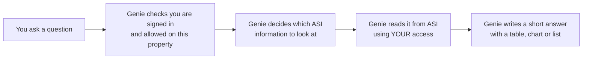

# ASI Genie — explained simply

## What is Genie?

Genie is the **chat assistant inside ASI** (our hotel property-management system). You type a question in plain English, and Genie looks up the answer in ASI for you.

Think of it as a colleague who knows where everything is in ASI and can read it very quickly — but **is not allowed to change anything**.

## Where do I find it?

1. Log in to ASI.
2. Open a **property** (Genie only works inside one property at a time).
3. Click the **Genie button** on the screen and start typing.

If you switch to a different property, Genie starts a fresh conversation for that property.

## What can I ask?

Ask the way you would ask a colleague. Spelling mistakes are fine.

| Area | Example questions |
|------|-------------------|
| Arrivals and departures | "Who arrives today?", "Who is checking out tomorrow?" |
| Guests and reservations | "Find the reservation for John Smith", "What is the balance on booking 12345?" |
| Rooms and housekeeping | "How many rooms are dirty?", "Show my housekeeping assignments" |
| Rates and availability | "What rooms are free next weekend?", "Show rate types" |
| Revenue and reports | "What was revenue last week?", "Show today's daily collection by payment type" |
| Night audit | "Has night audit run?", "Are we ready for night audit?" |
| Hotel terms | "What is RevPAR?", "What does ADR mean?" |
| Follow-ups | "Only cash", "What about yesterday?", "Yes, do it" |

"Today" in Genie means the hotel's **business date** (the night-audit date), not the calendar date on your computer.

## What Genie will NOT do

Genie **only reads** information. It will never:

- create, change, or cancel reservations
- take payments, refunds, or charge cards
- check guests in or out
- change room status, rates, or settings

If you ask for one of these, Genie tells you it can't and usually gives you a **button that opens the right ASI screen**, so you can do it yourself in one click.

Genie also stays on hotel topics. Ask it about the weather or programming and it will politely decline.

## How Genie answers a question

1. **You ask** a question in the chat.
2. **Genie checks** that you are signed in and that you have access to this property.
3. **Genie plans** which parts of ASI hold the answer (for example, the reservations list or a report).
4. **Genie reads** that information **with your own access rights**. If your role can't see something in ASI, Genie can't see it either.
5. **Genie answers** with a short sentence and, where useful, a table, chart, list, or a link to the full screen.

The numbers come straight from ASI. Genie copies them; it does not guess them.

## What answers look like

| You will see | When |
|--------------|------|
| A short sentence | Simple answers, greetings, definitions |
| Key numbers | "Revenue: $12,400 · Occupancy: 82%" |
| A table or list | Arrivals, guests, rooms, report rows |
| A chart | Trends over days or a breakdown (e.g. by payment type) |
| A checklist | Readiness checks, e.g. "Is night audit ready?" (✓ / warning / problem) |
| A button / link | Opens the matching ASI screen, e.g. the report or the create-reservation page |
| A question back to you | When Genie needs one more detail, e.g. "Which dates?" — tap an option |

Under each answer you can give a **thumbs up or thumbs down**. This helps the team improve Genie.

## Your data is safe

- **Your permissions apply.** Genie uses your own login, so it sees exactly what you can see in ASI — no more.
- **One property at a time.** Genie only reads the property you have open.
- **No card numbers.** If you type a credit card number, Genie hides it immediately, does not save it, and does not send it to the AI. Always use the payment terminal or payment screen for cards.
- **Read-only.** Genie cannot change anything in ASI.
- **Conversations are saved** (with card numbers hidden) so the team can review quality and fix problems.

## When something goes wrong

| Genie says | What it means | What to do |
|------------|---------------|------------|
| "Sign in to use Genie" / "Your session has expired" | Your login has timed out | Log in to ASI again |
| "You don't have access to …" / "That isn't available for your role" | Your role can't see this in ASI | Ask your manager or admin for access |
| "I couldn't reach ASI just now" / "… service didn't respond" | Part of ASI is slow or down | Wait a moment and ask again |
| "The assistant is busy right now…" (small note under the answer) | The AI was slow, so Genie used a simpler backup | The answer is still from ASI; ask again if it looks off |
| "I only help with this property in ASI…" | The question is outside hotel work | Ask about arrivals, rooms, rates, reports, etc. |

## Tips for better answers

- **Be specific with dates:** "revenue from 1 to 7 October" works better than "revenue recently".
- **Name the thing:** use the guest name, booking number, room number, or report name.
- **Narrow it down in a follow-up:** "only cash", "just room 204", "and yesterday?"
- **Use the buttons** Genie gives you — they take you straight to the right screen.

## Common words

| Word | Meaning |
|------|---------|
| Business date | The hotel's working day in ASI. It moves forward when night audit runs. |
| Night audit | The end-of-day process that closes the business date. |
| Folio | A guest's bill: charges and payments. |
| ADR | Average Daily Rate — average room price per sold room. |
| RevPAR | Revenue per available room. |
| Occupancy | Percentage of rooms that are sold. |
| In-house | Guests currently staying. |

## Questions or feedback?

Use the thumbs up / down on any answer, or contact the ASI Genie team.
